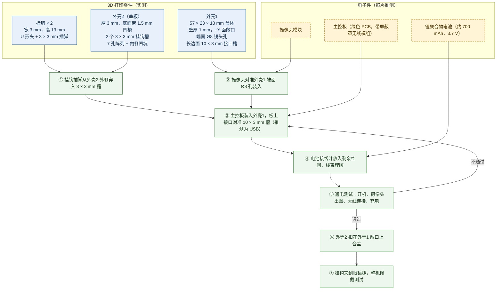
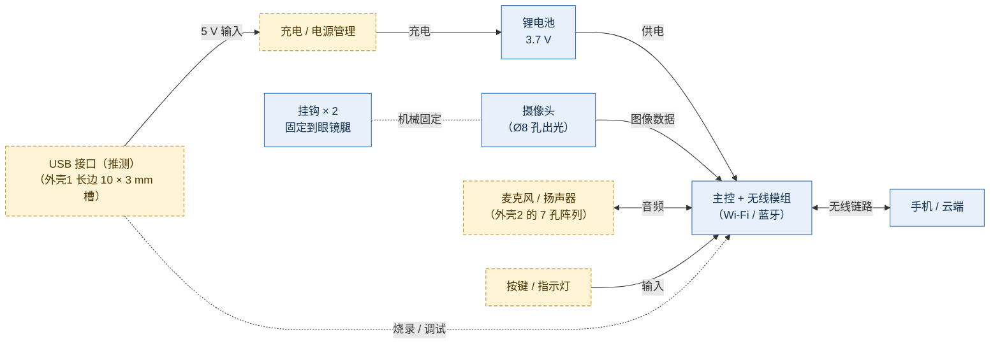
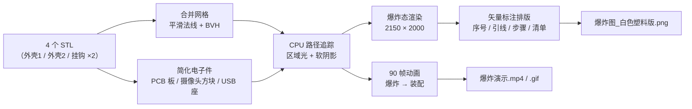
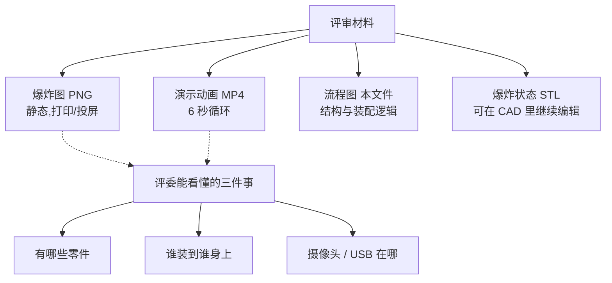
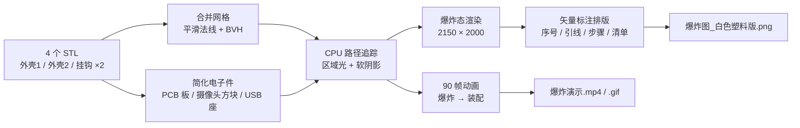
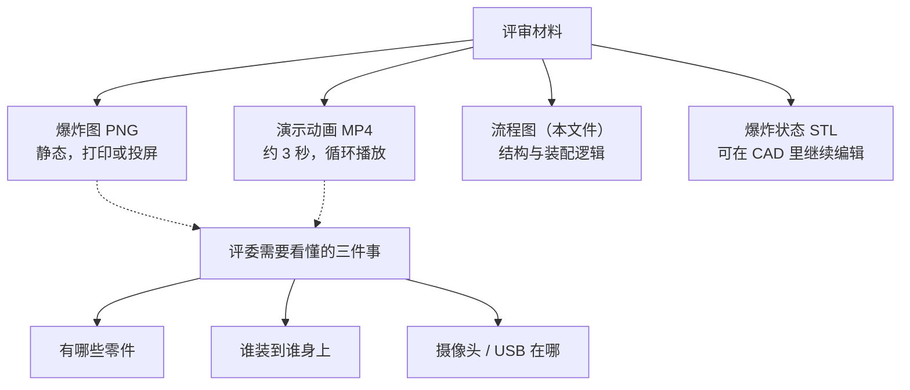

# 便携式智能眼镜框体：流程图

数据来源：四个 STL 的实测尺寸，加上两张实物照片。照片里的电子模块只能看出大概，图中虚线框的内容需要你确认。

已确认：外壳2 一端那颗黑色小方块是摄像头，出光口是外壳1 端面的 Ø8 圆孔；绿色 PCB 上有 ESP32 无线模组和 USB 口，USB 对着外壳1 长边的长条槽。

已确认：外壳2 一端那颗黑色小方块是摄像头，出光口是外壳1 端面的 Ø8 圆孔；绿色 PCB 上有 ESP32 无线模组和 USB 口，USB 对着外壳1 长边的长条槽。

## 图 1　零件组成与装配流程

## 图 2　硬件功能框图

## 需要你确认的地方

0. ~~外壳1 长边上的 10 × 3 mm 槽是不是 USB 口~~ → 已确认是 USB 口。
1. 外壳2 的 7 孔阵列是麦克风、扬声器还是别的用途。
2. 照片里主控板附近有一个小按键，不确定是否有对应的外壳开孔。外壳1 的 STL 里没有按键孔。
3. 图 1 的装配顺序是我按几何关系推出来的，实际顺序以你的装配为准。
4. 外壳1 和外壳2 之间的 STL 没有卡扣、止口或螺丝孔，合盖靠什么固定需要确认（见后续优化建议）。

## 图 3　渲染与演示产物

## 图 3　渲染与演示产物

