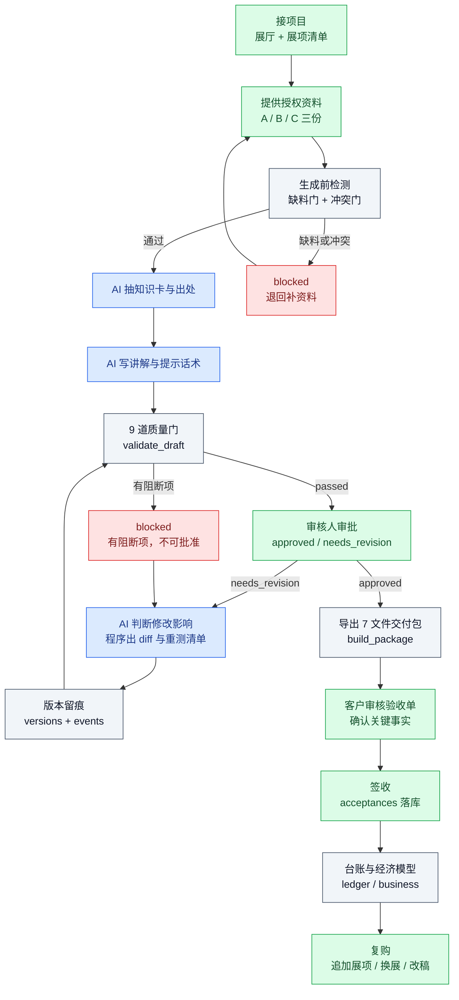
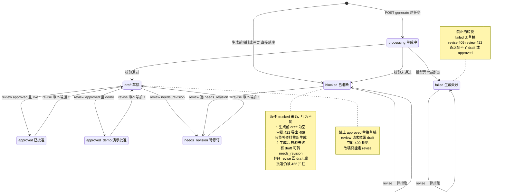
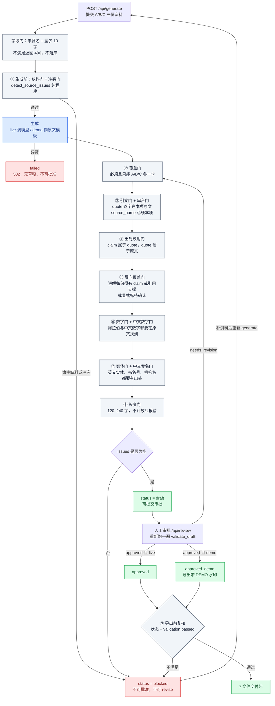
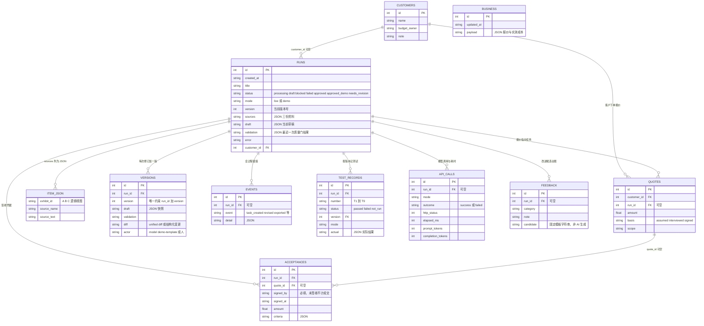
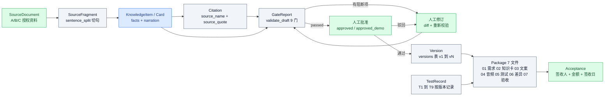

# 展览语音体验交付员：流程图集

本文件是 `exhibit_ai_employee\app.py`（v3.0）与《最终整合方案 V3.0》的可视化附件，共 5 张图。

看图的三条约定：

- **图 1、5 是业务视角**，回答"谁做什么、产物是什么"，用于路演和对外解释。
- **图 2、3 是代码视角**，逐条对照 `app.py` 的真实分支画出，包括设计上并不理想但代码确实允许的路径。两者若与《整合方案》不一致，以图 2、3 为准，并在图后说明差异。
- 三类执行主体用颜色区分：**AI 模型**（蓝）、**程序判定**（灰）、**人**（绿）、**阻断/失败**（红）。

---

## 图 1：客户交付全流程（业务视角）

**这张图回答什么问题：** 一个展陈集成商的项目从接单到复购，钱和活分别落在谁身上？哪些环节是 AI 在判断，哪些是程序在判定，哪些必须由人签字？

**看的时候注意：** 绿框（人工审核）和灰框（程序门）是"责任位"，不是效率优化对象。AI 只在三个蓝框里工作，其余都是程序拦截或人做决定。任何一条从"生成"直接跳到"交付"的边都不存在——图中没有这样的捷径，正是这个岗位的卖点。

**读图要点：** 客户只做三件不可替代的事——给授权资料、确认关键事实、签收。AI 的三件事都能被程序部分证伪（引文逐字、数字、覆盖），所以"AI 做了什么"可以被审计，这是与"通用 AI 写稿"的区别所在。签收（07 验收单 + `acceptances`）不等于硬件上线验收。

---

## 图 2：单次任务的内部状态机

**这张图回答什么问题：** 一个 `runs` 记录的 `status` 有哪 7 个取值，每个取值由哪个接口写入，哪些转换被代码显式拒绝（409 / 422 / 400）。

**看的时候注意三件事：**

1. `processing` 是**瞬时**状态，只在生成期间存在，正常返回后不会再看到它。
2. `blocked` 有两种来源，行为不同：**生成前**拦截（`draft` 为空 `{}`）根本不可审批；**生成后**校验失败（`draft` 有内容）能走审批接口，只是批准会被 422 挡住。
3. 代码里有一条**设计上不该存在但确实跑得通**的路径：`blocked --review:needs_revision--> needs_revision --> revise --> draft`。`/api/revise` 拒绝 blocked，但 `/api/review` 的状态判断只排除了 `failed/processing`，没有排除 `blocked`。这条路掩盖了"资料本身有问题"，演示时不要用它，也不要对外宣称 blocked 一定无法解除。

**被代码拒绝的转换（对照真实返回值）：**

| 尝试 | 返回 | 代码位置 |
|---|---|---|
| blocked → draft（用 revise 改文案解除） | 409「修改文案无法解除；请补充资料后重新生成」 | `/api/revise` |
| failed / processing → draft 或 approved | 409 无草稿 / 422 无可审批草稿 | revise + review |
| 审批时携带新 draft（审批替换草稿） | 400「审批不能替换草稿；请先通过修订接口」 | `/api/review` |
| 校验未过 → approved | 422「质量门未通过，不能批准」 | `/api/review` |
| 非 approved / approved_demo → 导出 | 409 | `/api/runs/{id}/export` |
| 非 approved / approved_demo → 登记签收 | 409 | `/api/acceptances` |

**另一处代码事实：** `revise` 把状态无条件写回 `draft`（`validation` 只是记录，不阻断），也就是说修订后仍可能带着未通过的校验停在 `draft`，靠随后 `/api/review` 重新校验并 422 兜住。状态机里"draft 代表可审"这一点，实际是"可提交审批"，不是"已合格"。

---

## 图 3：9 道质量门与拦截点

**这张图回答什么问题：** 一份资料从进来到变成交付包，一共被几道关检查、每道关拦什么、拦下之后只能走哪条路。

**看的时候注意：**

- 门口分三段：**生成前**（不调模型，省掉一次无效调用）、**生成后**（`validate_draft` 一个函数里串行跑完）、**导出前**（状态 + 校验双重复核）。生成前拦下的任务状态直接是 `blocked`，不产生 `api_calls` 记录。
- 引文门和串台门**共用一个计数器**：判定条件是 `source_name == sources[eid].source_name` 且 quote 逐字出现在**本展项**原文里。引用了别的展项的资料，就是串台，同一个检查拦下。
- 数字门与中文数字门、实体门与中文专名门，各自**合成一个计数器**，但报错文案分开写。
- 长度门**不进 `checks/total_checks` 计数**，只追加 issue。所以"通过 15/15"并不代表长度门被算过分，只代表它没报错。
- 反向覆盖门在代码里报的 issue 文案是「P0覆盖门…」（与第①道同名），看日志时别把两者搞混。

**9 道门的编号（与 SOP 的 P0 门对齐）：** ① 事实门（缺料）2 引文门 3 覆盖门 4 串台门 5 数字门（含中文数字）6 实体门（含中文专名）7 反向覆盖门 8 长度门 9 导出前复核。`validate_draft` 里的执行顺序与 SOP 的编号顺序不同，但拦的东西一致；图中按执行顺序画。

**每个检查点拦什么（一句话版）：**

| 检查点 | 拦什么 | 拦下后 |
|---|---|---|
| 字段门 | 缺来源名、资料不足 10 字、展项不是 A/B/C 三份 | 400，不建任务 |
| ① 缺料门 + 冲突门 | 显式"待补/未提供"标记、实义不足 40 字、资料内两个不同年份且语境重叠 | 409，落库 blocked，不调模型 |
| ② 覆盖门 | 卡片数不是 3，或展项编号集合不等于 A/B/C | blocked |
| ③ 引文门 + ④ 串台门 | 出处不在本展项原文里、source_name 对不上 | blocked |
| 出处映射门 | 事实缺 claim、claim 不在讲解里、quote 不在原文 | blocked |
| ⑦ 反向覆盖门 | 讲解里有整句找不到任何 claim/引用支撑 | blocked |
| ⑤ 数字门 + 中文数字门 | 讲解出现原文没有的阿拉伯数字或中文数字 | blocked |
| ⑥ 实体门 + 中文专名门 | 讲解出现原文没有的机构名、书名号内容、英文实体 | blocked |
| ⑧ 长度门 | 讲解不足 120 字或超过 240 字 | blocked（不计数） |
| ⑨ 导出前复核 | 状态不是 approved / approved_demo，或 validation 未通过 | 409，不出包 |

**回归集 `gates.py`：** 11 条固定用例（10 条断言通过/不通过，1 条只断言"不得误判缺料"），只喂输入给同一个 `validate_draft`、断言判定结果，**不是第二套门**。改动门的规则后必须全部仍通过，否则视为回归。它同时覆盖"应当拦下"与"不应误伤"两个方向——例如规范展签体（多句短句）不得被判缺料。

---

## 图 4：数据模型 / 表关系

**这张图回答什么问题：** 一个任务的全部证据（草稿、版本、事件、测试、调用、签收、报价）分别落在哪张表，靠什么外键串起来，哪些字段是 JSON 而不是独立表。

**看的时候注意：**

- **没有 `items` 表。** A/B/C 三份资料以 JSON 形式存在 `runs.sources` 列里，图 4 中的 `item_json` 只是这个 JSON 的逻辑视图，不是物理表。要按展项查询必须解析 JSON，这是当前实现的已知取舍。
- `api_calls.run_id`、`events.run_id`、`feedback.run_id` **可为空**：服务端级报错（`server_error`）和未绑定任务的反馈都会留下 `run_id = NULL` 的记录。
- `versions` 有 `UNIQUE(run_id, version)`，版本号在 `BEGIN IMMEDIATE` 事务内用 `UPDATE ... RETURNING` 原子自增，冲突时返回 409 而不是丢更新。
- `test_records` 带 `version` 和 `mode`，导出时**只取本版记录**，旧版记录单独列为"本版未重测"，避免客户把 v1 的验证当成本版结论。
- `quotes.basis` 有 CHECK 约束（assumed / interviewed / signed）。未签约时 `compute_economics` 拒绝输出利润率——分母没有意义。

**读图要点：** 左半边是"任务证据链"（runs → versions / events / test_records / api_calls），右半边是"商业证据链"（customers → quotes → acceptances）。两条链只通过 `runs` 一个点相连，意味着"这次交付值多少钱"可以从数据库查出来，不靠路演口述。`/api/ledger` 就是这两条链的汇总视图：客户数、报价数（按 assumed/interviewed/signed 分档）、签收数与金额、复购客户数——数字为 0 就是 0，不代表没有需求。

---

## 图 5：从资料到交付包的产物链

**这张图回答什么问题：** 中间一共生成哪些产物，每个产物由模型、程序还是人产生，哪一步之后产物才具备"可交付"资格。

**看的时候注意：** 蓝框（模型产出）全部要经过灰框（程序）证伪才进入下一环，绿框（人）是两个不可自动化的决定点——批准和签收。**`Package` 只能由已批准版本生成**，`Version` 每次 `revise` 加一，旧的版本与其 diff 永久保留，这是"修改可追踪"的物理证据。

| 产物 | 谁产生 | 落点 |
|---|---|---|
| SourceDocument | 人：客户 / 集成商提供，团队自制须标"模拟资料" | `runs.sources`（JSON） |
| SourceFragment | 程序：`sentence_split` 按句切分 | 内存，不单独落表 |
| KnowledgeItem / Card | 模型：抽事实、写讲解与提示话术 | `runs.draft`、`versions.draft` |
| Citation | 模型给出，程序逐字校验 | 卡片内 `citations`、`facts` |
| GateReport | 程序：`validate_draft` 纯规则 | `runs.validation`、`versions.validation` |
| Version | 程序：原子自增 + `difflib` 生成 diff | `versions` |
| TestRecord | 程序记录，人填实际结果 | `test_records` |
| Package | 程序：`build_package` 拼装 | `/export` 响应，不落盘 |
| Acceptance | 人：客户签收人签字登记 | `acceptances` + 07 文件 |

**两处必须说清的产物缺口：** `04_音频/README.md` 明确写着本包不含任何音频文件——岗位叫"语音体验交付员"，但系统当前不产出音频，录音由谁完成必须在 07 验收单里书面约定。`06` 中的"待解决问题"是模板化的四条加报价状态，不是模型归纳出来的。
